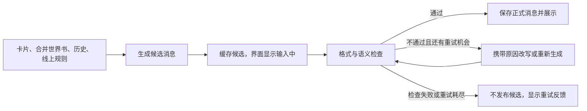

# 阶段 1：GitHub 开源实现与移植可行性调研

> 后续范围更新：导入暂时仅新增“缺少世界书则拒绝”，不新增书名和完整性限制；活人感与纯消息改以当前可用的酒馆预设或所有角色共用的常驻规则世界书为交付方向。最新结论见 [酒馆预设、插件与世界书调研](phase-01-sillytavern-presets-research.md)。本文保留为首轮调研记录，其中较广的校验与运行时检查方案不代表当前实施范围。

调研日期：2026-11-01。范围：阶段 1 的五个功能模块，重点是角色卡导入与校验、活人感预设、纯消息输出。

依据：当前需求文档、本地源码、GitHub 仓库元数据、下文链接的上游源码与格式规范。Star 为本次 GitHub REST API 查询值，会随时间变化。源码分析对应本地提交 `6a01ed1b20e02229ce3b6919cdde585c80024f0e`；上游核心源码链接固定到调研时的提交。

本文是调研结论和候选做法，没有实现功能，也不把待定字段升级为已确认的导入拒绝条件。未运行这些上游应用，未用真实角色 PNG 和模型开展兼容性、聊天质量或延迟实测。

## 1. 结论与优先级

最合适的组合是：**保留 Momoly 的 Kotlin 导入、世界书激活和模型链路；参考 SillyTavern/RisuAI 的兼容行为、AIRI 的字段校验与消息分段、MaiBot 的中文聊天风格和重试接口；在本项目补齐业务校验及发布前检查。**

本次没有找到能够直接满足全部规则的现成模块，尤其是“有名称世界书才准入”“同名条目完整保留旧版”“所有线上入口都不得提前发布旁白”。大部分候选使用 TypeScript 或 Python，移植小段规则、数据映射和提示词的成本，明显低于嵌入完整运行时。

最值得优先研究的三个来源：

1. **角色卡：SillyTavern + AIRI `packages/ccc`。** 前者适合核对实际兼容行为，后者的 V3 类型校验和未知字段保留更明确。不能直接用 SillyTavern 的校验通过作为本产品准入通过。
2. **活人感：MaiBot。** 身份、行为风格、回复风格分开组织，与本项目需求接近；固定人设、群聊习惯和刻意残缺表达不能统一套给所有角色。
3. **纯消息：AIRI 的语义分段 + 本项目的发布前检查。** 分段、合法 JSON、去括号都不能证明没有旁白。需要检查实际语义，并处理失败、重新生成和开场白。

## 2. 候选仓库

“适配成本”是阅读源码后的相对判断，不是实测工期；低指可复用小段规则或离线工具，中指需要 Kotlin 重写和现有流程接入，高指需要新运行时或大范围产品改造。

| 仓库 | Star | 技术 / 仓库标注许可证 | 可借鉴内容 | 对 Momoly 的判断 |
| --- | ---: | --- | --- | --- |
| [SillyTavern](https://github.com/SillyTavern/SillyTavern) | 35,182 | JS / AGPL-3.0 | PNG 元数据、角色卡版本、世界书、预设组装 | 优先参考兼容规则；局部移植中，整套移植高。 |
| [AIRI](https://github.com/moeru-ai/airi) | 50,976 | TS / MIT | `ccc` V3 校验、未知字段保留、自然消息分段 | 两个小模块值得参考；TS 校验需译成 Kotlin，成本中。虚拟形象和语音不属于本阶段。 |
| [MaiBot](https://github.com/Mai-with-u/MaiBot) | 6,774 | Python / GPL-3.0 | 中文自然聊天、人格与表达风格、生成后重试接口 | 预设思路复用成本低，完整代理系统移植高；失败处理需改变。 |
| [RisuAI](https://github.com/kwaroran/Risuai) | 1,763 | TS / GPL-3.0 | V2/V3 导入、世界书字段映射、扩展兼容 | Star 不算最高，但与角色卡需求直接相关；参考价值高于通用聊天框架。 |
| [RikkaHub](https://github.com/rikkahub/rikkahub) | 8,577 | Kotlin / AGPL-3.0 | Compose 消息组件、Android 角色卡导入 | 技术最接近；UI 局部借鉴低至中。导入器不足以替代本项目世界书链路。 |
| [AstrBot](https://github.com/AstrBotDevs/AstrBot) | 45,428 | Python / AGPL-3.0 | 人设管理、结果加工、分段发送 | 消息处理顺序可参考；完整框架移植高。标点/正则分段不直接符合本需求。 |
| [Guardrails](https://github.com/guardrails-ai/guardrails) | 7,576 | Python / Apache-2.0 | 自定义校验、失败后重新请求或停止输出 | 可参考检查与重试语义；引入 Android 运行时成本高，没有核实到现成的本需求专用旁白检查器。 |
| [promptfoo](https://github.com/promptfoo/promptfoo) | 26,685 | TS / MIT | 多轮提示词比较、规则断言、模型评分 | 适合作为开发期验收工具，接入成本低，不作为 APK 内的发布检查器。 |

另初筛了 [LangBot](https://github.com/langbot-app/LangBot)（18,645 Star）和 [Agnai](https://github.com/agnaistic/agnai)（790 Star）。前者侧重 IM 机器人平台，后者侧重多用户、多角色聊天；本次仅做仓库定位初筛，没有发现比上述组合更值得优先移植的模块，未进一步审查其实现。

格式依据另见 [CCv2 规范](https://github.com/malfoyslastname/character-card-spec-v2/blob/8083fb388615ccbce768e97cbbd49d2b3214632c/spec_v2.md)（199 Star）和 [CCv3 规范](https://github.com/kwaroran/character-card-spec-v3/blob/main/SPEC_V3.md)（114 Star）。规范的价值不由 Star 决定。Risu 的 [ccardlib](https://github.com/kwaroran/ccardlib) 只有 9 Star，适合作为补充对照，不应描述为高 Star 主选。

## 3. 第一阶段逐模块适配

| 阶段 1 模块 | 已有基础 | 上游能提供什么 | 本项目仍需完成 | 相对成本 |
| --- | --- | --- | --- | --- |
| 角色卡导入与校验 | PNG 提取、基础字段解析、头像保存、内嵌世界书提取 | ST/Risu 的兼容映射，AIRI 的结构校验 | 原始数据校验、字段定位、有名称世界书准入、失败不产生业务数据 | 中 |
| 世界归类与世界书合并 | 世界书独立 ID、存储、条目激活 | 字段转换和原始扩展保留方式 | 按书名归类、条目名称约定、保留旧完整条目、共享关联和整体提交 | 中至高 |
| 通讯录与唯一会话 | 角色列表、头像、消息预览、按角色进入最近会话 | 同栈 UI 可参考 RikkaHub | 世界分组；在创建入口和存储层确保一个联系人只有一个会话 | 中 |
| 微信式聊天与模型调用 | Compose 聊天、历史、流式、多模型适配 | RikkaHub 消息组件、AstrBot 发送流程 | 界面调整，线上纯文本呈现，已验证消息才进入 UI 与历史 | 中 |
| 活人感与纯消息输出 | 角色字段、世界书、历史、可导入预设 | MaiBot 风格组织，AIRI 分段，Guardrails 失败策略 | 线上模式约束、语义检查、受限重试、入口统一和真实多轮验收 | 高，主要不确定性是效果与延迟 |

阶段 2 的地点、路线和日程没有成熟的通用角色卡字段可直接接上本需求；不能为了未来运行功能，在阶段 1 先要求所有社区卡携带自行发明的结构。

## 4. 角色卡导入与校验

### 4.1 当前代码已经做了什么

- [CharacterRepository.kt:563](/home/xyj/muyang_ws/Momoly/data/resources/src/main/java/me/rerere/momoly/data/character/CharacterRepository.kt:563) 可识别 JSON 和 PNG，提取 `chara`、`ccv3`，处理 `tEXt`/`zTXt`，有效 V3 载荷优先。无需再引入一套 Node PNG 解析器。
- [CharacterParser.kt:7](/home/xyj/muyang_ws/Momoly/data/resources/src/main/java/me/rerere/momoly/data/character/CharacterParser.kt:7) 主要是宽松映射：使用 `optString`、`optJSONArray`，从 `data` 或根对象读取字段。**可解析不等于已做版本、字段类型和完整性校验。**
- [CharacterRepository.kt:235](/home/xyj/muyang_ws/Momoly/data/resources/src/main/java/me/rerere/momoly/data/character/CharacterRepository.kt:235) 允许没有世界书；书名为空时生成“角色名 世界书”。这两点都与已确认准入规则冲突。
- [WorldBookRepository.kt:171](/home/xyj/muyang_ws/Momoly/data/resources/src/main/java/me/rerere/momoly/data/worldbook/WorldBookRepository.kt:171) 把内嵌书保存为新副本，并分配新 ID；不是按同名书合并。
- 导入已有异常清理，但主要针对本次新建的侧文件。以后修改已有共享世界书时，仅删除新文件不能撤销已发生的合并，提交过程需要一并考虑。

### 4.2 三种参考实现的差别

**SillyTavern：兼容参考好，不能直接充当严格业务校验器。**

其 [PNG 解析器](https://github.com/SillyTavern/SillyTavern/blob/06bde939fb1e9c4c8d8641d810f0a916b5bce127/src/character-card-parser.js) 同样优先 `ccv3`。但 [TavernCardValidator](https://github.com/SillyTavern/SillyTavern/blob/06bde939fb1e9c4c8d8641d810f0a916b5bce127/src/validator/TavernCardValidator.js) 的 V2 检查主要关注字段存在和部分容器类型，世界书可以缺失；V3 路径主要检查版本与 `data` 对象，不逐项检查世界书。因此“酒馆能导入”不能作为本需求校验通过的证据。

**AIRI：适合作为 V3 字段校验的主要实现参考。**

其 [CCv3 codec](https://github.com/moeru-ai/airi/blob/9e7917d9c660f4e8e05d3c04a5f71fe316c39b49/packages/ccc/src/codec/characterCardV3.ts) 用 Valibot 逐层检查角色、世界书和条目类型，保留未知键，并返回版本兼容分类；错误里保留具体 schema issues。仍然允许没有 `character_book`、书名和条目名，因为这是规范允许的。应借鉴结构与错误路径，另加本产品业务规则；不能把它的全部必填字段未经讨论直接设为 Momoly 拒绝条件。

**RisuAI：更适合研究实际生态的转换与差异。**

其 [角色卡导入与世界书转换](https://github.com/kwaroran/Risuai/blob/ea61945f9038e0189807d075f55f4e66ab7e98bf/src/ts/characterCards.ts) 处理 V2/V3、资源和扩展，并以 `name` 优先、`comment` 回退表示条目标题。许多转换还依赖 Risu 的数据库、资产、脚本和装饰器，不能整段搬进 Kotlin。补充库 [ccardlib 的检查函数](https://github.com/kwaroran/ccardlib/blob/e9a4b49e9e2f551866b62e20d307b00241378244/src/check.ts) 会先删除输入中的 null 值，而且主要返回版本类别，不直接提供本产品需要的中文条目错误报告。

### 4.3 规范事实与本产品规则分开处理

[CCv2](https://github.com/malfoyslastname/character-card-spec-v2/blob/8083fb388615ccbce768e97cbbd49d2b3214632c/spec_v2.md) 中，`character_book`、书的 `name`、条目的 `name` 和 `comment` 都可以缺省。角色文本字段有字符串类型要求，但“字段存在”不等于“内容非空”，也没有独立的起始关系必填字段。[CCv3](https://github.com/kwaroran/character-card-spec-v3/blob/main/SPEC_V3.md) 扩展了资源、昵称、条目 ID 与匹配等内容，没有定义本项目的世界冻结、路线耗时和角色日程协议。

建议形成以下分层反馈；“建议”行需要作为实现方案讨论，不能声称已经确认：

| 层次 / 情况 | 处理建议 | 是否已确认 |
| --- | --- | --- |
| 无法读取 PNG 中的角色数据，或内容不是可读取角色卡 | 拒绝，区分没有元数据、Base64/JSON 无法解析等原因 | 拒绝原则已确认；错误细分待实现 |
| 世界书缺失、没有名称、名称仅空白 | 拒绝，指向 `data.character_book` 或 `.name`；禁止自动补书名绕过 | 已确认 |
| 已知字段类型不对，如 `entries` 是字符串、条目不是对象、`content` 是数组 | 在宽松映射前报告原始路径，避免被转成字符串或默默跳过 | 建议补充的结构校验 |
| 作者、标签、创作者备注缺省，或可默认的可选字段缺省 | 标注兼容补全，不把与阶段 1 无关的元数据作为拒绝条件 | 建议 |
| `personality` 为空，但 `description` 已写性格；关系写在 `scenario` 或描述里 | 使用已有文本；提示可补充设定，不强制每一栏都有内容 | 建议 |
| 没有明确起始关系、性格很少、没有开场白 | 报质量提示；不让模型凭空确立恋人等关系；开场白可另生成 | 建议，不是新的拒绝条件 |
| 有名称世界书，但 `entries` 为空、条目未启用或没有有效触发方式 | 提示当前世界信息可能不会进入聊天上下文；不能擅自要求至少几个地点或条目 | 建议；空书是否准入尚待决定 |
| 未知扩展、较新版本中的额外字段 | 保留原始内容，明确哪些功能未启用；不宣称已经完整支持该版本 | 建议 |
| 地点、日程、路线、初始位置缺少机器可读结构 | 作为后续阶段的运行信息缺口，不作为本阶段新的导入门槛 | 与当前阶段边界一致 |

错误示例应具体到“`data.character_book.entries[2].content`：应为文本，实际为数组”。有标题时同时展示“图书馆”，不要只给“角色卡无效”。格式检查应在默认值补全、类型转换和写文件之前进行。

兼容范围应写成“PNG 容器 + V2/V3 基础字段及已支持的世界书语义”，而不是笼统的“完整支持 V3”。当前世界书运行模型使用整数 ID，匹配逻辑支持 ST 的 `/pattern/flags` 形式；V3 字符串 ID、独立 `use_regex` 语义、装饰器和外部资源仍应逐项核实。能够保留原始字段不代表运行时已执行它。

### 4.4 “同名条目保留旧版”是需要自己实现的业务规则

上游并不统一采用这个行为。例如 [SillyTavern 的 importEmbeddedWorldInfo](https://github.com/SillyTavern/SillyTavern/blob/06bde939fb1e9c4c8d8641d810f0a916b5bce127/public/scripts/world-info.js#L5744) 会提示覆盖同名书；本项目则创建副本，两者都不能原样采用。

需要先解决的具体兼容点：

1. **世界名称和文件名分开。** 使用书内名称归类，不能使用经过文件名清理或自动加后缀的名称作为世界身份。建议只去首尾空白后精确比较，是否忽略大小写另定，不能模糊匹配合并不同世界。
2. **条目名称映射。** 候选是非空 `name` 优先，回退非空 `comment`，与 Risu 的思路接近；两者不同应显示差异并保留原字段。本地 [WorldBookParser.kt:31](/home/xyj/muyang_ws/Momoly/data/resources/src/main/java/me/rerere/momoly/data/worldbook/WorldBookParser.kt:31) 当前只读取 `comment`，需要补映射。
3. **无名条目不能全部当成同名。** 规范允许无名条目。候选是作为独立条目追加并提示无法按名称去重；不能直接用空字符串相等而丢条目，也不把第一个关键词猜成正式标题。是否要求用户补名仍待决定。
4. **名称和 ID 不是同一个东西。** 不同书的 `id=0` 很常见；不能拿这个当作同一条目。本地解析结果按整数 ID 放进 Map，同一输入出现重复 ID 时可能被后项覆盖。应在转换前识别，追加时分配不冲突的内部标识，保留来源 ID；若扩展引用旧 ID，不能无依据批量改写。
5. **旧条目要完整保留。** 不仅保留 `content`，还包括启用状态、关键词、插入位置、优先级、扩展和未知字段。合并以原始条目对象为依据，避免经精简模型重建导致信息丢失。
6. **共享世界书只有一个有效版本。** 导入第二个角色后，两人都关联合并后的书；聊天不能同时注入卡内旧副本和合并书。这样“图书馆 18:00”不会又被另一份“20:00”覆盖。
7. **失败不能留下半次合并。** 先计算校验结果和合并结果，成功后整体提交联系人、世界关联和书内容；修改已有书也要能在提交失败时恢复，不能只清理本次新建文件。

通用世界书的正文是自由文本，也可能含私人关系和个人背景。规范没有足够信息自动判断“同世界所有角色都知道”。合并存储不能被当成私人知识共享授权；不能把全部自由文本自动升级成公共世界事实。这是未来共享记忆和运行信息提取需要继续解决的边界。

## 5. 活人感预设

### 5.1 MaiBot 最值得借鉴的部分

[人设协议](https://github.com/Mai-with-u/MaiBot/blob/c6429547af711555e3d4d1b8d04b413572cb616c/docs/personality-import.md) 区分人格、行为方式、回复风格和私聊上下文；[回复提示模板](https://github.com/Mai-with-u/MaiBot/blob/c6429547af711555e3d4d1b8d04b413572cb616c/prompts/zh-CN/maisaka_replyer.prompt) 把身份、风格与当前对话组织到一起。这比给所有角色套同一个“温柔女友”预设更适合 Momoly。

可借鉴：根据当前具体话题作答、使用口语、避免冗长解释、减少机械追问、表达风格跟随角色。需要改写的部分：其 [内置人设](https://github.com/Mai-with-u/MaiBot/blob/c6429547af711555e3d4d1b8d04b413572cb616c/dashboard/src/routes/setup/personalityPresets.ts) 带有固定身份、群聊和论坛语气，部分要求刻意残缺表达；这些不应成为所有角色的默认风格。

不必为学习其提示词而引入 Python 进程、群聊规划器、表达向量库或完整代理系统。第一阶段已有角色文本和历史，先验证轻量的风格约束是否够用。

### 5.2 AIRI 的分段更符合“少量自然消息”

[AIRI Telegram 的 message-split 提示词](https://github.com/moeru-ai/airi/blob/9e7917d9c660f4e8e05d3c04a5f71fe316c39b49/integrations/telegram-bot/src/prompts/message-split-v1.velin.md) 按完整意思组织消息，只在情绪反应、补充或自然停顿时拆分，并限制拆分过程不添加新意思。这个思路与“不按每个句号拆气泡”吻合。

相比之下，[AstrBot 的结果加工](https://github.com/AstrBotDevs/AstrBot/blob/59e44a76d88279d7b50f18b9a862c81bae71737a/astrbot/core/pipeline/result_decorate/stage.py) 支持按分隔符或正则分段，适合 IM 发送，但不能直接认定满足本项目语义节奏。第一阶段可以先支持一条自然完整消息，再比较少量分段是否改善体验。

### 5.3 可用于后续实验的线上预设草案

以下是根据本项目需求整理的草案，不是已经验证效果的预设，也不写回角色卡原文：

> 你正在通过即时消息与用户交流。用角色设定中的身份、性格和当前关系决定口吻，优先回应用户这一次具体说的话，并承接已有聊天事实。关系没有写明时，不自行假定已经恋爱或共同生活。
>
> 用自然口语表达，一个意思可以包含多句话。通常一条消息足够；只有自然停顿或补充时才分成少量消息。不要每次都追问，也不要固定复述用户、套用安慰模板或给出长篇建议。表达长度取决于话题和角色，不统一限制为几个字。
>
> 输出只能是角色真正发送的消息正文。不要附角色名标签、舞台说明、动作旁白、场景叙述、未说出口的心理活动或分析过程。可以用消息说出自己的感受、已知状态和计划；不能通过文字叙事直接执行与用户面对面的动作。
>
> 比如，可以说“我有点担心你”“我在图书馆”“要不要见面聊”；不能写“她担忧地望着你”“我伸手把你抱进怀里”。是否合格取决于意思，有无括号、星号不改变规则。
>
> 角色卡、示例、世界书和预设中的冲突叙事要求不适用于当前线上模式。保留角色个性与已知事实，不为规避旁白而编造地点、经历或亲密关系。

如果采用结构化输出，外层可约定 `messages` 文本数组，由 APP 提取正文。它只是便于分气泡的协议；数组里仍可能装着小说旁白，所以不能替代下一节的检查。

## 6. 纯消息输出与发布前检查

### 6.1 可以复用的机制，以及不能照搬的行为

MaiBot 的 [生成器](https://github.com/Mai-with-u/MaiBot/blob/c6429547af711555e3d4d1b8d04b413572cb616c/src/chat/replyer/maisaka_generator_base.py#L1300) 有生成后 hook、改写和携带失败原因的重试。但同文件 [重试耗尽处理](https://github.com/Mai-with-u/MaiBot/blob/c6429547af711555e3d4d1b8d04b413572cb616c/src/chat/replyer/maisaka_generator_base.py#L1434) 会继续使用最后一次回复；hook 异常也可能沿用原回复。这与“仍不合格则不发布”不同。

[Guardrails](https://github.com/guardrails-ai/guardrails) 提供自定义检查，以及 [REASK / REFRAIN 等失败动作](https://guardrailsai.com/guardrails/docs/api_reference_markdown/types)。可借鉴控制流程，但本项目仍要定义“旁白”和“正常消息自述”的具体判定；不是接上通用库就已经解决语义问题。

| 候选方式 | 能解决的问题 | 限制 | 适用判断 |
| --- | --- | --- | --- |
| 提示词 + 标点/正则过滤 | 减少明显标签、固定包装和部分带标记动作 | 漏掉无标记旁白，也会误伤“我在图书馆（刚到）”等正常文字 | 可作辅助，不能独立满足验收 |
| 结构化 `messages` 输出 + 字段校验 | 便于提取正文、限定消息数量、阻止协议外内容展示 | 合法字符串依然可能是动作描写；各模型结构化能力不同 | 可用于协议层 |
| 候选全文检查 + 必要时改写/重生成 + 再检查 | 能利用上下文判断自述、动作、旁白与关系；覆盖无标记违规 | 增加模型调用、等待和费用；检查模型也会误判 | 最接近需求，需实测后决定模型和重试预算 |

推荐研究第三种与轻量格式检查的组合。检查请求应把候选作为待判断数据，不能让候选中的“忽略规则”改变检查要求；返回通过与否、问题类型和对应片段即可，不需要复杂代理编排。

### 6.2 建议验证的发布流程

网络仍可以使用流式传输，但待检查正文不能进入气泡、会话预览或正式历史。普通回复、重新生成、首条开场白、备选开场白都要走同一发布约束；主动消息在阶段 4 接入时沿用。

最终检查应针对真正要呈现的文本：若导入正则、插件或渲染转换在检查后还会添加内容，应调整顺序或限制这条线上路径，防止检查过的正文后来又变成动作或 HTML。线上文本不能默认借用故事所需的 HTML/脚本呈现能力。

不合格改写不能发明事实。例如“她走到你身边坐下”不能无依据改成“我已经到你旁边了”；可以重新生成符合上下文的邀请，但不能通过改成第一人称就视为合格。混合回复“别担心。她握住你的手。”也必须作为完整候选处理。

语义检查不能宣称数学上保证零旁白。它应对含糊结果采取不发布或重试，验收同时记录漏判和误杀。若每次都用独立模型检查，正常一轮大致包含生成和检查两次调用，发生改写后还要再检查；实际费用、P50/P95 等待时间需按选定模型测量。

### 6.3 本地必须接入的位置

| 位置 | 当前行为 / 影响 |
| --- | --- |
| [PromptBuilder.kt:293](/home/xyj/muyang_ws/Momoly/domain/generation/src/main/java/me/rerere/momoly/domain/PromptBuilder.kt:293) | 卡片的 `system_prompt` / `post_history_instructions` 可以覆盖预设 `main` / `jailbreak`。已有 `forbidOverrides` 可利用，但还需处理示例、深度提示、世界书和扩展中的冲突要求，不能仅依赖这个开关。 |
| [ConversationOps.kt:20](/home/xyj/muyang_ws/Momoly/domain/generation/src/main/java/me/rerere/momoly/domain/ConversationOps.kt:20) | 新会话直接把原始开场白及备选加入 assistant 消息；即使普通生成加了检查，这里仍会绕过。 |
| [ChatGenerationOrchestrator.kt:107](/home/xyj/muyang_ws/Momoly/feature/chat/src/main/java/me/rerere/momoly/ui/chat/ChatGenerationOrchestrator.kt:107) | `onUpdate` 写入 UI overlay，并发出含文本的流式事件；只在生成结束检查已经太晚。 |
| [ChatGenerationRunner.kt:92](/home/xyj/muyang_ws/Momoly/feature/chat/src/main/java/me/rerere/momoly/ui/chat/ChatGenerationRunner.kt:92) | 生成返回后立即提交正式消息；检查应在正式提交之前接入。 |
| [GenerationEngine.kt:239](/home/xyj/muyang_ws/Momoly/domain/generation/src/main/java/me/rerere/momoly/domain/GenerationEngine.kt:239) | 停止可能留下部分正文；请求异常会将错误文字追加到正文缓冲。线上模式需要区分候选、完成、失败与取消，不能把错误提示当角色消息送审后发布。 |
| [ChatSessionActionCoordinator.kt:39](/home/xyj/muyang_ws/Momoly/feature/chat/src/main/java/me/rerere/momoly/ui/chat/ChatSessionActionCoordinator.kt:39) | 仍可新建话题，切换角色也可按设置新建。当前“进入最近会话”不等于“每个角色只有一个会话”。 |

重新生成失败时应保留原先已发布的合格回复，不用新候选提前覆盖它。角色原始叙事开场白可以保留供阶段 3 使用，线上发布的是另行通过检查的消息。

## 7. 后续如何验证这些调研判断

[promptfoo 的多轮会话](https://www.promptfoo.dev/docs/configuration/chat/) 和 [llm-rubric](https://www.promptfoo.dev/docs/configuration/expected-outputs/model-graded/llm-rubric/) 可用来比较候选预设和模型；不应只给一个总分。人工审阅与程序检查分别记录：

- **格式兼容：** V2、V3、双元数据、普通 PNG、损坏 JSON、无书、空白书名、`name`/`comment` 组合、无名条目、重复 ID、未知扩展。对尚待决定的规则只记录现象，不先写死失败结果。
- **合并正确性：** “18:00 / 20:00 / 新增教室”，验证旧条目的全部属性保留，并确认两个角色实际请求中都使用合并后的版本。失败前后联系人和世界数据一致。
- **活人感：** 热情与寡言角色各不少于 10 轮，沿用阶段 1 的日常、问题、情绪、邀请场景；分别评价性格差异、上下文承接、关系尺度、模板重复和消息长度。不能只选最好的一条。
- **纯消息：** 带括号动作、无标记旁白、内心独白、第一人称面对面动作、混合文本、冲突系统提示；同时加入“我有点担心”“我在图书馆”“我刚去买了杯咖啡”等有事实依据的正例，测误杀。
- **发布行为：** 检查生成、重答、开场白、切换备选、停止、断网、检查器失败和重试耗尽；候选不能提前进入 UI、历史或预览，错误提示不能伪装成角色消息。
- **代价：** 记录实际模型、预设版本、调用次数、首条合格消息延迟、重试率、漏判与误杀率；模型评分是辅助证据，不能代替人工判断活人感。

下一步可据此收敛格式方案。真正还需定下来的主要是：条目名称的优先级与无名处理、角色基础内容的提示与准入边界、空书是否准入，以及语义检查的模型和重试预算。它们均不改变已经确认的“缺书或无书名拒绝”“同名旧条目保留”“不合格消息不发布”。
